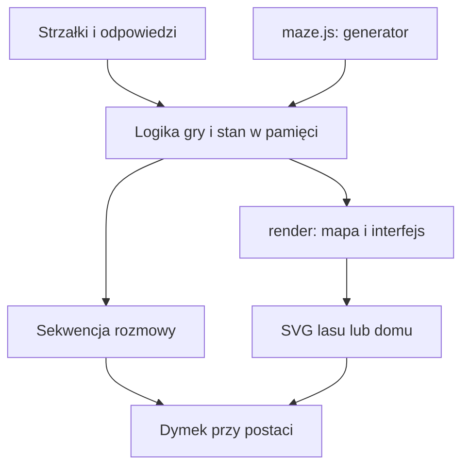

# Architektura — Adam w lesie

Stan opisany: 2026-10-17. Dokument opisuje obecną implementację. Uzasadnienia wyborów i ich zmiany zapisujemy w [ADR](decisions/README.md).

## Cel i granice systemu

Gra pomaga dziecku około 7 lat ćwiczyć czytanie po polsku. Gracz prowadzi Adama przez losowy las, pomaga zwierzętom, zdobywa klucz i wraca do domu. Interfejs jest przeznaczony przede wszystkim na telefon: duże strzałki, krótkie teksty i ekran bez przewijania całej strony.

To statyczna aplikacja HTML/CSS/JavaScript uruchamiana w przeglądarce. Nie ma backendu, kont, bazy danych, zewnętrznych bibliotek ani etapu kompilacji. Stan rozgrywki istnieje tylko w pamięci; odświeżenie strony rozpoczyna nową grę.

## Kod i odpowiedzialności

| Miejsce | Odpowiedzialność |
| --- | --- |
| `maze.js` | Generowanie grafu labiryntu, wybór domu, bramy i lokalizacji zwierzaka z kluczem. |
| `index.html`: `start`, `move`, `target`, `addDanger` | Rozpoczęcie gry, ruch i rozmieszczanie spotkań. |
| `fpv.js`: `neighbor`, `corridor`, `render` | Kierunki w grafie i perspektywiczna scena FPV: ścieżki, zieleń, furtka, zwierzęta i dom. |
| `index.html`: `setView`, `handleDirection`, `renderScene`, `updateControls` | Przełączanie widoku oraz tłumaczenie ruchu względem kierunku patrzenia. |
| `index.html`: `render` | Aktualizacja widoku, plecaka, dostępnych akcji; tworzenie obsługi odpowiedzi i nagród. |
| `index.html`: `draw`, `terrainArt`, `characterArt`, `drawHome` | Ilustracje SVG: teren, ścieżki i postacie; finał wyświetla ilustrację PNG w SVG. |
| `index.html`: `showEvent`, `paintDialogue`, `positionBubble`, `closeEvent` | Sekwencje wypowiedzi i dymek przy mówiącej postaci. |
| `index.html`: HTML i CSS | Układ ekranu, przyciski, plecak i menu. |

To podział odpowiedzialności wewnątrz pliku, a nie osobne moduły. Logika gry i operacje DOM są obecnie połączone. Generator jest niezależny od DOM: udostępnia `window.generateMaze` oraz eksport CommonJS do uruchamiania w Node.js.

## Model danych

| Stan | Znaczenie |
| --- | --- |
| `maze.n`, `maze.cells` | Rozmiar siatki i lista pól `{id, links}`; `links` zawiera identyfikatory sąsiadów połączonych przejściem. |
| `maze.start`, `maze.exit` | Pole startowe i dom. Identyfikator pola to `y * n + x`. |
| `maze.gate` | Dwa końce krawędzi blokowanej przez bramę. Brama nie usuwa połączenia z grafu; sprawdza ją logika ruchu. |
| `maze.keeper`, `maze.places` | Pole zwierzaka z kluczem oraz miejsca spotkań. |
| `pos`, `visited`, `done`, `encounters` | Pozycja Adama, odwiedzone pola, wykonane zadania i spotkania indeksowane polem. |
| `seenSamples`, `seenPath` | Zapamiętane pozycje zasięgu i suma odsłoniętych obszarów, niezależna od licznika odwiedzonych pól. |
| `viewMode`, `facing` | Wybrany widok (`map` lub `fpv`) i kierunek patrzenia (0 północ, 1 wschód, 2 południe, 3 zachód). |
| `hearts`, `hasKey`, `gateOpen`, `won`, `lost` | Ekwipunek i stan zakończenia gry. |
| `dialogueSteps`, `dialogueIndex` | Lista kwestii `{speaker, icon, name, text}` i indeks bieżącej wypowiedzi. |
| `terrain`, `terrainCache`, `artSeed` | Dane dekoracji i przygotowany obraz terenu. Nie określają dostępności przejść. |

## Generowanie poziomu

1. `generateMaze(n, random = Math.random)` tworzy siatkę dla rozmiarów używanych przez UI: 4, 6 i 8.
2. Losowy DFS ze stosem łączy wszystkie pola bez cykli. Między dowolną parą pól istnieje jedna ścieżka.
3. BFS wyznacza odległości od startu w lewym dolnym rogu. Najdalsze pole staje się domem.
4. Na ścieżce do domu wybierana jest krawędź bramy. Przeszukanie grafu z pominięciem tej krawędzi wyznacza obszar dostępny przed bramą.
5. Zwierzak z kluczem trafia do tego obszaru. Pozostałe miejsca spotkań są wybierane osobno.
6. `start()` dobiera zadania, a `addDanger()` umieszcza wilka na trasie do domu, z wyłączeniem domu, zwierzaka z kluczem i końców bramy. Wilk może zastąpić zwykłe spotkanie.

Parametr `random` umożliwia deterministyczne sprawdzanie generatora. Cała gra nie ma jeszcze wspólnego ziarna losowości: dobór zadań i dekoracji korzysta również z `Math.random`.

## Przebieg gry i reguły

- `start()` resetuje stan, ustawia 3 serca, generuje poziom i pokazuje wstęp Adama.
- `move()` sprawdza sąsiedztwo, bramę, otwarte menu/rozmowę i nierozwiązane spotkanie z wilkiem. Po ruchu aktualizuje odwiedzone pola oraz widok.
- Przy spotkaniu mówi Adam, potem zwierzak. Odpowiedzi pojawiają się przy ostatniej kwestii. Dymek to niemodalny element `dialog.show()`; ruch podczas rozmowy blokuje kod gry. Menu nadal używa `showModal()`.
- Wykonanie zadania daje jedno serce tylko raz. Zadanie zwierzaka `keeper` daje dodatkowo klucz. Rozmowa zamyka się bez komunikatu o sukcesie, a zwierzak pozostaje na mapie.
- Wilk losuje `count` (1–5) i `direction` (góra/prawo/dół/lewo). `renderWolfTask()` buduje cztery strzałki, pasek wybranych kroków, cofanie i zatwierdzanie. `steps` przechowuje kierunki kliknięć, także po zamknięciu dymka. Dopiero zatwierdzenie porównuje długość i wszystkie kierunki z poleceniem. To odpowiedź na zadanie: nie przenosi Adama przez pola labiryntu. Zobacz [ADR-0004](decisions/0004-wolf-directions.md).
- Błędna odpowiedź u przyjaznego zwierzaka nie zabiera serca. Błąd u wilka zabiera jedno; przy zerze gra się kończy. Zamknięcie dymka nie pozwala ominąć nierozwiązanego wilka.
- Klucz pozwala otworzyć bramę. Dom uruchamia `drawHome()`: Adam i siostra z radością idą ku sobie, a końcowe kwestie pojawiają się przy postaciach. Finał używa zaakceptowanej ilustracji `assets/home-reunion.png`; przezroczyste obszary SVG nad każdą postacią wyznaczają pozycje dymków. Powitanie siostry brzmi „Dobrze cię widzieć!”.

## Animacja chodzenia w 2D

`startWalk()` animuje pojedynczy dozwolony ruch przez 360 ms. `roadCurve()` jest wspólnym źródłem krzywych dla rysowania ścieżki i interpolacji pozycji. Podczas kroku `requestAnimationFrame` aktualizuje tylko transformacje postaci, jej kończyn i kolejność warstw; nie odrysowuje całej mapy w każdej klatce.

Obszar widoczności powiększa się wzdłuż drogi postaci i zachowuje wszystkie odsłonięte fragmenty. Pole docelowe trafia do `visited`, a pozycja logiczna zmienia się dopiero przy zakończeniu animacji; wtedy otwiera się ewentualna rozmowa lub finał. Dodatkowy ruch jest zablokowany do zakończenia kroku. Nowa gra anuluje trwającą animację, a otwarcie menu lub zmiana widoku kończy ją przed wykonaniem akcji. FPV zachowuje ruch krokowy bez tej animacji. `prefers-reduced-motion: reduce` i brak API animacji oznaczają natychmiastowe przejście.

Testy z kontrolowanym zegarem sprawdzają ruch, opóźnienie rozmów, blokady, restart, przełączanie widoków i preferencję ograniczenia ruchu. Sprawdzono także statyczne fazy chodu; płynność w prawdziwej przeglądarce pozostaje niezweryfikowana z powodu niedostępnego podglądu.

## Widoczność i ucieczka wilka

W 2D `rememberSight()` dopisuje do `seenPath` zamknięte, nieregularne obszary o promieniu około 67 jednostek wokół Adama (pole ma 60×60). Ich kształt wynika ze stałego ziarna przygody i pozycji, więc nie migocze przy odrysowaniu. Wszystkie kontury mają ten sam kierunek i tworzą sumę obszarów; pamięć tylko rośnie. `rememberWalk()` zapisuje 17 stałych próbek wzdłuż krzywej kroku, stopniowo podczas animacji i w całości przy jej zakończeniu. Identyczna droga jest zapamiętywana przy pominiętych klatkach, ograniczeniu animacji i ruchu FPV. Zbiór `seenSamples` eliminuje powtórzenia podczas wracania tą samą trasą.

`sightDefinitions()` tworzy jedną maskę SVG z bezpośrednią ścieżką i rozmyciem Gaussa 3,5 jednostki. Maska obejmuje wspólną grupę terenu, ścieżek, drzew, zwierząt, furtki i Adama, zapewniając spójny miękki brzeg oraz unikając wielokrotnego nakładania masek na każdy obiekt. Nie używa `use` do grupy wewnątrz `clipPath`, co wcześniej powodowało znikanie zwierząt. Podczas chodu zmienia się tylko ścieżka maski i transformacje postaci; sortowanie warstw odbywa się wewnątrz grupy sceny.

Każdy odsłonięty fragment, również części sąsiednich nieodwiedzonych pól, pozostaje widoczny do końca bieżącej gry. Pamięć działa po odejściu, powrocie i zmianie widoku. Nie dopisuje pól do `visited` ani miniatury FPV. „Pokaż całą mapę” jest tymczasowym podglądem, który nie kasuje zebranej pamięci. Nowa gra lub odświeżenie strony zeruje pamięć razem z resztą stanu.

Poprawna odpowiedź wilkowi przyznaje jedno serce i zapisuje `done` jak dotychczas. `startFlee()` pokazuje przez 750 ms podskoki, ruch łap oraz oddalanie i zanikanie wilka. W 2D wilk odbiega w las, w FPV maleje w perspektywie. Ruch gracza jest zablokowany tylko do końca tej krótkiej animacji. Po niej `animalPresent()` oraz renderer FPV pomijają rozwiązanego wilka, także po ponownym wejściu na pole lub zmianie widoku. Przyjazne zwierzęta nadal zostają na mapie.

Nowa gra anuluje ucieczkę. Zmiana widoku i otwarcie menu kończą ją bez ponownego przyznania serca. Przy ograniczeniu animacji lub braku API wilk znika natychmiast. Testy obejmują oba widoki, błędne odpowiedzi, jednorazową nagrodę, restart, zmianę widoku i śledzenie zasięgu widzenia podczas kroku.

## Widok FPV

Przełącznik wybiera drugi renderer tego samego stanu, bez tworzenia nowej przygody. W FPV ↑/↓ wywołują istniejące `move()` w kierunku patrzenia lub przeciwnym, a ←/→ obracają kamerę o 90°. Ruch nadal respektuje graf, furtkę, rozmowy i nierozwiązanego wilka. W trybie mapy udany ruch ustawia kierunek patrzenia na ostatni kierunek marszu.

`ForestFPV.corridor()` wyznacza do pięciu kolejnych pól przed graczem i ich boczne połączenia. Widoczność kończy się na ścianie lub zamkniętej furtce. Renderer rzutuje ścieżki, zieleń i furtkę na SVG, korzystając ze wspólnych ilustracji zwierząt i drzew. Nie wymaga WebGL ani dodatkowych bibliotek. Na scenie FPV kompas zastępuje napis o kierunku patrzenia. Miniaturowa mapa w prawym górnym rogu pokazuje odwiedzone pola, ścieżki i strzałkę pozycji oraz orientacji Adama. Ustawienie „Pokaż całą mapę” odsłania także miniaturę. Północ zawsze jest na górze, niezależnie od obrotu kamery.

Rozmowy w FPV są zakotwiczone w obszarze sceny, ponieważ postać Adama jest kamerą. Finał zachowuje istniejący obraz z siostrą.

Zobacz [ADR-0005](decisions/0005-first-person-view.md).

## Grafika i układ

Mapa jest płaska, a elementy mają styl 2,5D dzięki kształtom, cieniom i kolejności rysowania SVG. To nie jest silnik 3D. Krzywe ścieżki wynikają z połączeń grafu; dekoracje nie zmieniają zasad ruchu. `placeHills()` wybiera według ziarna przygody część narożników między polanami, z pominięciem wody i zewnętrznej krawędzi mapy. `hillArt()` rysuje pagórki z jasnym stokiem, cieniem, kamieniami i okazjonalnym kwiatem. Trafiają do `terrainCache`, pod ścieżkami i postaciami, więc podlegają tej samej zapamiętywanej masce mgły. FPV ma dodatkowo cieniowane wzgórza w tle; są dekoracją horyzontu, nie dodatkowymi przejściami. Zwierzęta na mapie 2D zawsze stoją po prawej stronie swojego pola, w tej samej pozycji i skali co podczas spotkania z Adamem. Podejście i odejście chłopca nie przesuwa ani nie skaluje zwierząt. Widoczne zwierzęta w 2D oraz FPV delikatnie kołyszą się i oddychają dzięki animacji CSS wewnętrznej grupy SVG; cień i pozycja na mapie pozostają stałe. Faza animacji wynika ze wspólnego zegara i gatunku, aby odrysowanie mapy nie rozpoczynało jej od nowa. Preferencja ograniczenia ruchu wyłącza tę animację.

`positionBubble()` używa prostokątów ekranowych SVG i kontenera mapy. Wybiera miejsce nad lub pod postacią, ogranicza dymek do kontenera i aktualizuje położenie przy zmianie rozmiaru. Zwierzak jest obecnie wybierany jako najbliższy widoczny zwierzak względem Adama. To zależność, którą trzeba uwzględnić przy zmianie układu postaci.

## Uruchamianie i publikacja

W repozytorium GitHub `index.html`, `maze.js` i `fpv.js` leżą w katalogu głównym. Można otworzyć HTML bezpośrednio lub uruchomić `python3 -m http.server 8080`. Hosting wymaga jedynie serwowania tych plików statycznych; kod nie wymaga usług serwerowych.

Istniejąca publikacja Sites korzysta z osobnego repozytorium źródłowego, katalogu `dist/` oraz manifestu `.openai/hosting.json`. Zapis do GitHuba nie jest sam w sobie publikacją Sites. Repozytorium GitHub nie zawiera obecnie workflow wdrażania GitHub Pages.

## Weryfikacja i ograniczenia

Zestaw `node --test tests/*.test.cjs` obejmuje testy własności generatora na 3000 mapach oraz 300 pełnych przejść gry, 30 przegranych i restarty dla rozmiarów 4, 6 i 8. Testy przebiegów sterują grą przez przyciski i odpowiedzi w symulowanym DOM, bez teleportowania postaci i dopisywania ekwipunku. `tests/helpers/game.cjs` przyjmuje rozmiar i ziarno, a błąd testu generatora lub reguł podaje ziarno do odtworzenia przez `TEST_SEED` (szczegóły w README). Kontrolowane losowanie dotyczy wyłącznie testów; T09 pozostaje osobnym zadaniem. Pozostałe testy sprawdzają furtkę i dymki, prośby zwierząt, zadanie wilka, animacje i FPV. Nie ma CI; to T04. Testy mgły obejmują trwałość odsłoniętych fragmentów, niezależność od animacji i FPV, blokady ruchu oraz reset. Osobny raster SVG potwierdził miękkie krawędzie, widoczność zwierzaka i furtki oraz brak ponownego zasłaniania pikseli po odejściu. Testy logiki i rastrów nie zastępują kontroli układu w przeglądarce.

W ramach T03 przygotowano `tests/browser/` i konfigurację Playwright dla trzech viewportów mobilnych, mapy i FPV. Testy scen korzystają z prawdziwego DOM i zdarzeń przeglądarki, ale ustawiają kontrolowane pozycje i spotkania; nie zastępują pełnych przebiegów T01. Zależność Playwright jest wyłącznie narzędziem deweloperskim. Testy przeglądarkowe oraz kontrola prawdziwego telefonu pozostają niewykonane z powodu blokady zarządzanego podglądu. Uruchomienie, zakres i checklista: [browser-tests.md](browser-tests.md).

Przy zmianach sprawdzaj: spójność grafu, dostępność klucza przed bramą, blokadę bramy, jednorazowe nagrody, serca i ponowne próby u wilka, kolejność rozmów, finał oraz reset gry. Na telefonie sprawdzaj widoczność strzałek, czytelność dymków, orientację ekranu i brak przewijania całej strony.

Możliwe dalsze usprawnienia, jeszcze niewdrożone: wydzielenie stanu i reguł z DOM, rozszerzenie testów generatora, osobne dane dialogów, wspólne ziarno losowości, zapis postępu. Istotne zmiany tych obszarów należy poprzedzić ADR.

### Aktualne zamykanie rozmów — 2026-10-17

„Dalej” przechodzi przez wypowiedzi, a po ostatniej wywołuje `closeEvent()`. Przycisk jest dostępny także na etapie wyboru odpowiedzi; samo zamknięcie nie rozwiązuje zadania, nie daje klucza i nie kasuje szkicu kroków wilka. Kliknięcia poza otwartym dymkiem są pochłaniane, bez zamykania go i bez działania na elementy pod nim. Escape nadal zamyka rozmowę. Strzałki klawiatury pozostają zablokowane podczas rozmowy i menu, a po ich zamknięciu sterują mapą lub FPV zgodnie z aktualnym widokiem. Pola formularzy zachowują własną obsługę klawiatury.

`npcLine()` tworzy także prośbę posiadacza klucza: „Dam ci klucz, jeśli dasz mi …”, z formą gramatyczną z `itemCatalog`. Wilk zatwierdza kroki przyciskiem „Skaczę”. Reguły nagród i ruchu pozostają wspólne dla przycisków i klawiatury.

### Chmurka przy przyjaznym zwierzaku — 2026-10-17

`#talk` jest przyciskiem HTML nad sceną, z małą chmurką SVG i obszarem dotyku 44×44 px. `positionTalk()` kotwiczy go przy `data-encounter` równym aktualnemu polu i ogranicza do obszaru mapy. Oba renderery oznaczają zwierzęta identyfikatorem pola; odległe postacie nie otrzymują przycisku. Położenie aktualizuje się po renderowaniu i zmianie rozmiaru. Ikona jest ukryta podczas dialogu/menu, chodzenia, ucieczki wilka, po wykonaniu zadania i po końcu gry.

Po wejściu na pole przyjaznego zwierzaka `showArrivalEvent()` pozostawia rozmowę do otwarcia chmurką lub dotychczasowym przyciskiem pod mapą. Wilk, furtka i finał zachowują dotychczasową obsługę. „Dalej” bez rozwiązania zadania przywraca dostęp do chmurki. Ukończone zadanie usuwa ją; ponowne otwarcie nie daje nagrody. `tests/conversation-icon.test.cjs` i test chodzenia sprawdzają te przejścia w mapie oraz FPV. Przypadki dotyku, klawiatury i granic mapy dodano do oczekującego zestawu przeglądarkowego T03.

### Wygląd wilka — 2026-10-17

`characterArt('🐺')` ma osobny rysunek SVG: wyraźne brwi, bursztynowe oczy, małe kły, kudłate policzki i pierś oraz szerzej ustawione łapy. Chłodne szarości i proste kształty zachowują stylistykę pozostałych zwierząt. Wszystkie widoki korzystają z tej samej ilustracji. Zachowano `animal-idle` i znaczniki `data-animal-foot`, więc oddychanie oraz ucieczka nadal działają.

Sprawdzono raster SVG starego i nowego rysunku oraz 45 istniejących testów przedmiotów/zadania wilka, FPV i ucieczki; wszystkie przeszły. To weryfikacja grafiki i logiki, bez kontroli całego układu w przeglądarce — podgląd nadal jest niedostępny.

### Miękkie brzegi ścieżek — 2026-10-17

Mapa 2D zastępuje ciemny kontur ścieżek szerokim, półprzezroczystym poboczem oraz lekko rozmytym, jaśniejszym środkiem. Filtry `path-shoulder` i `path-soft` mają jawne granice w jednostkach mapy. Obejmują tylko warstwy dróg, zachowując dotychczasowe krzywe, połączenia i maskę odkrytego obszaru.

FPV zbiera podłoże wszystkich widocznych odcinków i bocznych przejść w jedną grupę, a następnie zmiękcza jej brzeg filtrem `fpv-path-soft`. Wspólny gradient w jednostkach ekranu usuwa skoki koloru między odcinkami. Kamienie, roślinność, furtki, postacie, kompas i minimapa pozostają poza filtrem.

Porównano rendery SVG mapy i FPV przed i po zmianie. Wszystkie 23 istniejące testy mgły, chodzenia i FPV przeszły. Nie wykonano kontroli całego interfejsu w przeglądarce z powodu niedostępnego podglądu.

### Kolejność rysowania furtki i chłopca — 2026-10-17

`wicketSprites()` zwraca osobne warstwy cienia, obu słupków i skrzydła. Głębokość każdego elementu wynika z jego położenia przy ziemi po projekcji, dzięki czemu otwarte skrzydło na poziomej ścieżce znajduje się za Adamem. Wcześniej cała furtka miała jedną głębokość i zasłaniała twarz chłopca. Istniejąca animacja chodzenia porządkuje postać między tymi warstwami w trakcie kroku. Geometria furtki, blokowanie przejścia i FPV nie zmieniły się.

Osiem przypadków w `tests/gate-depth.test.cjs` sprawdza ustawienie po obu stronach poziomej i pionowej furtki oraz przechodzenie w czterech kierunkach. Cztery z nich odtwarzają błąd w poprzednim kodzie. Porównano też rastry SVG przed i po zmianie dla czterech ustawień. Wszystkie 49 testów furtki, dymków, chodzenia i FPV przeszły. Kontrola interfejsu w przeglądarce pozostaje niewykonana z powodu niedostępnego podglądu.
