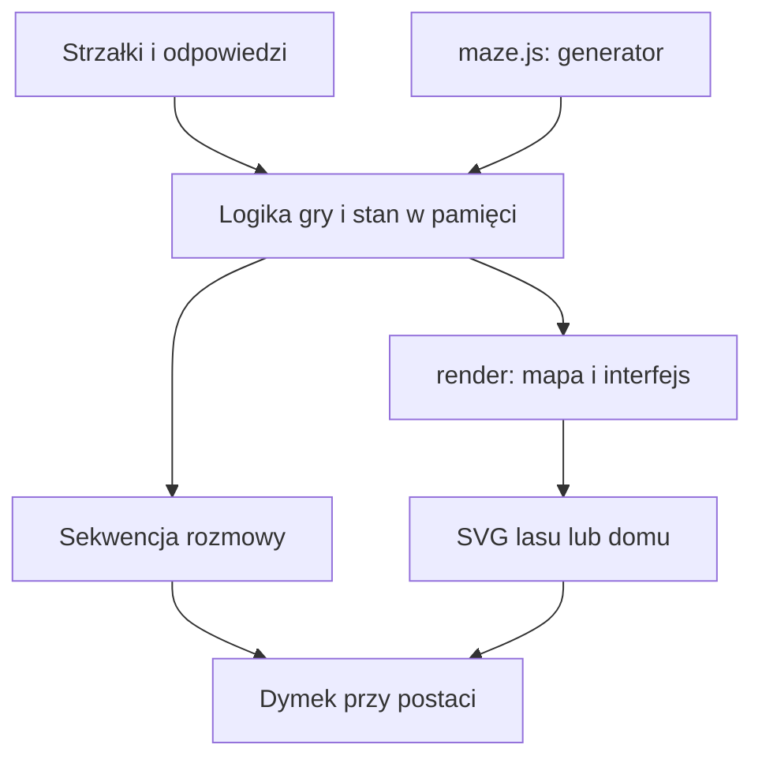

# Architektura — Adam w lesie

Stan opisany: 2026-10-16. Dokument opisuje obecną implementację. Uzasadnienia wyborów i ich zmiany zapisujemy w [ADR](decisions/README.md).

## Cel i granice systemu

Gra pomaga dziecku około 7 lat ćwiczyć czytanie po polsku. Gracz prowadzi Adama przez losowy las, pomaga zwierzętom, zdobywa klucz i wraca do domu. Interfejs jest przeznaczony przede wszystkim na telefon: duże strzałki, krótkie teksty i ekran bez przewijania całej strony.

To statyczna aplikacja HTML/CSS/JavaScript uruchamiana w przeglądarce. Nie ma backendu, kont, bazy danych, zewnętrznych bibliotek ani etapu kompilacji. Stan rozgrywki istnieje tylko w pamięci; odświeżenie strony rozpoczyna nową grę.

## Kod i odpowiedzialności

| Miejsce | Odpowiedzialność |
| --- | --- |
| `maze.js` | Generowanie grafu labiryntu, wybór domu, bramy i lokalizacji zwierzaka z kluczem. |
| `index.html`: `start`, `move`, `target`, `addDanger` | Rozpoczęcie gry, ruch i rozmieszczanie spotkań. |
| `index.html`: `render` | Aktualizacja widoku, plecaka, dostępnych akcji; tworzenie obsługi odpowiedzi i nagród. |
| `index.html`: `draw`, `terrainArt`, `characterArt`, `drawHome` | Ilustracje SVG: teren, ścieżki, postacie i finał w domu. |
| `index.html`: `showEvent`, `paintDialogue`, `positionBubble`, `closeEvent` | Sekwencje wypowiedzi i dymek przy mówiącej postaci. |
| `index.html`: HTML i CSS | Układ ekranu, przyciski, plecak i menu. |

To podział odpowiedzialności wewnątrz pliku, a nie osobne moduły. Logika gry i operacje DOM są obecnie połączone. Generator jest niezależny od DOM: udostępnia `window.generateMaze` oraz eksport CommonJS do uruchamiania w Node.js.

## Model danych

| Stan | Znaczenie |
| --- | --- |
| `maze.n`, `maze.cells` | Rozmiar siatki i lista pól `{id, links}`; `links` zawiera identyfikatory sąsiadów połączonych przejściem. |
| `maze.start`, `maze.exit` | Pole startowe i dom. Identyfikator pola to `y * n + x`. |
| `maze.gate` | Dwa końce krawędzi blokowanej przez bramę. Brama nie usuwa połączenia z grafu; sprawdza ją logika ruchu. |
| `maze.keeper`, `maze.places` | Pole zwierzaka z kluczem oraz miejsca spotkań. |
| `pos`, `visited`, `done`, `encounters` | Pozycja Adama, odwiedzone pola, wykonane zadania i spotkania indeksowane polem. |
| `hearts`, `hasKey`, `gateOpen`, `won`, `lost` | Ekwipunek i stan zakończenia gry. |
| `dialogueSteps`, `dialogueIndex` | Lista kwestii `{speaker, icon, name, text}` i indeks bieżącej wypowiedzi. |
| `terrain`, `terrainCache`, `artSeed` | Dane dekoracji i przygotowany obraz terenu. Nie określają dostępności przejść. |

## Generowanie poziomu

1. `generateMaze(n, random = Math.random)` tworzy siatkę dla rozmiarów używanych przez UI: 4, 6 i 8.
2. Losowy DFS ze stosem łączy wszystkie pola bez cykli. Między dowolną parą pól istnieje jedna ścieżka.
3. BFS wyznacza odległości od startu w lewym dolnym rogu. Najdalsze pole staje się domem.
4. Na ścieżce do domu wybierana jest krawędź bramy. Przeszukanie grafu z pominięciem tej krawędzi wyznacza obszar dostępny przed bramą.
5. Zwierzak z kluczem trafia do tego obszaru. Pozostałe miejsca spotkań są wybierane osobno.
6. `start()` dobiera zadania, a `addDanger()` umieszcza wilka na trasie do domu, z wyłączeniem domu, zwierzaka z kluczem i końców bramy. Wilk może zastąpić zwykłe spotkanie.

Parametr `random` umożliwia deterministyczne sprawdzanie generatora. Cała gra nie ma jeszcze wspólnego ziarna losowości: dobór zadań i dekoracji korzysta również z `Math.random`.

## Przebieg gry i reguły

- `start()` resetuje stan, ustawia 3 serca, generuje poziom i pokazuje wstęp Adama.
- `move()` sprawdza sąsiedztwo, bramę, otwarte menu/rozmowę i nierozwiązane spotkanie z wilkiem. Po ruchu aktualizuje odwiedzone pola oraz widok.
- Przy spotkaniu mówi Adam, potem zwierzak. Odpowiedzi pojawiają się przy ostatniej kwestii. Dymek to niemodalny element `dialog.show()`; ruch podczas rozmowy blokuje kod gry. Menu nadal używa `showModal()`.
- Wykonanie zadania daje jedno serce tylko raz. Zadanie zwierzaka `keeper` daje dodatkowo klucz. Rozmowa zamyka się bez komunikatu o sukcesie, a zwierzak pozostaje na mapie.
- Wilk losuje `count` (1–5) i `direction` (góra/prawo/dół/lewo). `renderWolfTask()` buduje cztery strzałki, pasek wybranych kroków, cofanie i zatwierdzanie. `steps` przechowuje kierunki kliknięć, także po zamknięciu dymka. Dopiero zatwierdzenie porównuje długość i wszystkie kierunki z poleceniem. To odpowiedź na zadanie: nie przenosi Adama przez pola labiryntu. Zobacz [ADR-0004](decisions/0004-wolf-directions.md).
- Błędna odpowiedź u przyjaznego zwierzaka nie zabiera serca. Błąd u wilka zabiera jedno; przy zerze gra się kończy. Zamknięcie dymka nie pozwala ominąć nierozwiązanego wilka.
- Klucz pozwala otworzyć bramę. Dom uruchamia `drawHome()`: Adam przytula siostrę, a końcowe kwestie pojawiają się przy postaciach.

## Grafika i układ

Mapa jest płaska, a elementy mają styl 2,5D dzięki kształtom, cieniom i kolejności rysowania SVG. To nie jest silnik 3D. Krzywe ścieżki wynikają z połączeń grafu; dekoracje nie zmieniają zasad ruchu. Postacie na wspólnym polu są przesunięte, aby obie pozostały widoczne.

`positionBubble()` używa prostokątów ekranowych SVG i kontenera mapy. Wybiera miejsce nad lub pod postacią, ogranicza dymek do kontenera i aktualizuje położenie przy zmianie rozmiaru. Zwierzak jest obecnie wybierany jako najbliższy widoczny zwierzak względem Adama. To zależność, którą trzeba uwzględnić przy zmianie układu postaci.

## Uruchamianie i publikacja

W repozytorium GitHub `index.html` i `maze.js` leżą w katalogu głównym. Można otworzyć HTML bezpośrednio lub uruchomić `python3 -m http.server 8080`. Hosting wymaga jedynie serwowania tych plików statycznych; kod nie wymaga usług serwerowych.

Istniejąca publikacja Sites korzysta z osobnego repozytorium źródłowego, katalogu `dist/` oraz manifestu `.openai/hosting.json`. Zapis do GitHuba nie jest sam w sobie publikacją Sites. Repozytorium GitHub nie zawiera obecnie workflow wdrażania GitHub Pages.

## Weryfikacja i ograniczenia

Zestaw `node --test tests/*.test.cjs` sprawdza furtkę i dymki, prośby zwierząt oraz zadanie wilka w symulowanym DOM. Nie ma CI. Testy logiki nie zastępują kontroli układu w przeglądarce.

Przy zmianach sprawdzaj: spójność grafu, dostępność klucza przed bramą, blokadę bramy, jednorazowe nagrody, serca i ponowne próby u wilka, kolejność rozmów, finał oraz reset gry. Na telefonie sprawdzaj widoczność strzałek, czytelność dymków, orientację ekranu i brak przewijania całej strony.

Możliwe dalsze usprawnienia, jeszcze niewdrożone: wydzielenie stanu i reguł z DOM, rozszerzenie testów generatora, osobne dane dialogów, wspólne ziarno losowości, zapis postępu. Istotne zmiany tych obszarów należy poprzedzić ADR.
